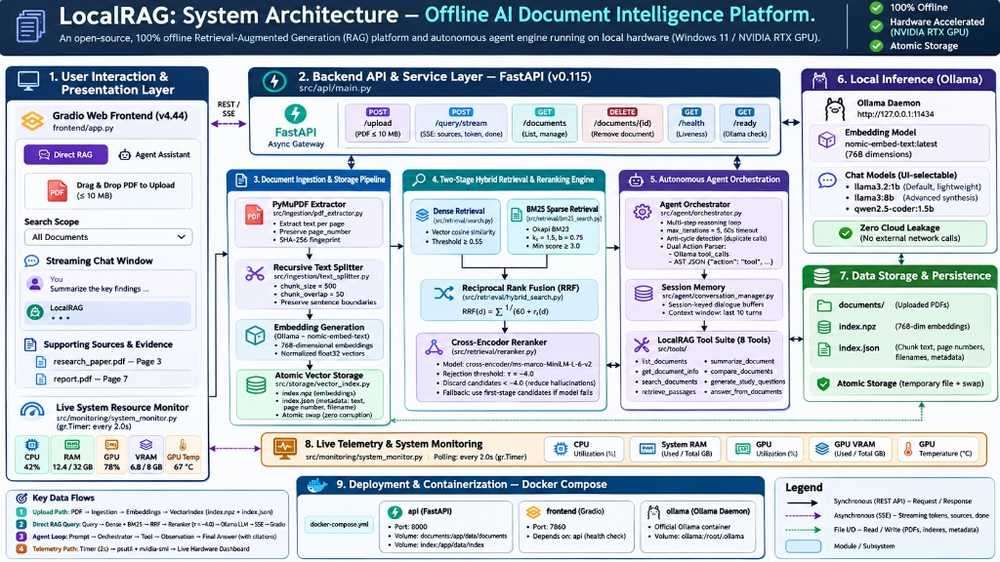
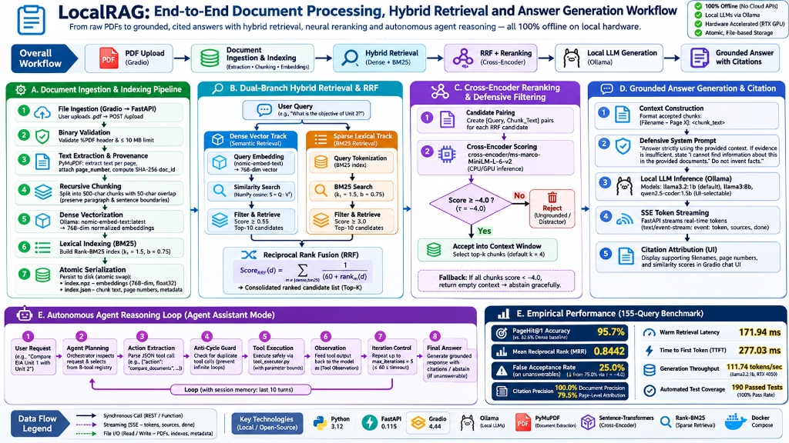

# LocalRAG

<p align="center">
  <strong>Your Documents. Your AI. Your Hardware. Zero Cloud Dependency.</strong>
</p>

<p align="center">
  
  
  
  
  
  
  
  
  
</p>

<p align="center">
  <a href="#overview">Overview</a> •
  <a href="#key-features">Key Features</a> •
  <a href="#system-architecture">System Architecture</a> •
  <a href="#end-to-end-workflow">End-to-End Workflow</a> •
  <a href="#technical-deep-dive">Technical Deep Dive</a> •
  <a href="#benchmark-results">Benchmark Results</a> •
  <a href="#hardware-telemetry">Hardware Telemetry</a> •
  <a href="#technology-stack">Tech Stack</a> •
  <a href="#project-structure">Project Structure</a> •
  <a href="#installation-and-setup">Installation & Setup</a> •
  <a href="#roadmap">Roadmap</a>
</p>

---

<a id="overview"></a>
## Overview

**LocalRAG** is an open-source, local-first document intelligence platform and autonomous AI assistant. It combines two-stage hybrid retrieval (NumPy dense semantic search + Okapi BM25 sparse lexical search), Reciprocal Rank Fusion (RRF), neural Cross-Encoder reranking, defensive hallucination filtering, and multi-step autonomous agent reasoning—running **100% offline on consumer hardware with zero cloud API dependencies**.

### The Problem It Solves

Modern cloud-based document AI solutions suffer from four fundamental shortcomings:
1. **Data Sovereignty & Privacy Hazards**: Uploading proprietary technical reports, medical summaries, or legal briefs to cloud APIs risks data leakage and violates compliance mandates.
2. **The Vocabulary Gap**: Dense vector embeddings frequently struggle with exact technical identifiers, function names, and acronyms (`ARIES`, `RecLSN`, `TIME_WAIT`), while pure lexical search fails on semantic paraphrasing.
3. **Hallucination on Negative Queries**: Conventional RAG systems force-feed the closest candidate chunks into the prompt context even when the document does not contain the answer, causing language models to hallucinate plausible-sounding falsehoods.
4. **Lack of Provenance**: Users cannot verify claims without tedious manual document searches because standard chatbots provide ungrounded text without exact page citations.

### The LocalRAG Approach

LocalRAG addresses these challenges through a principled, dual-stage engineering architecture:
- **Zero Cloud Leakage**: Document parsing, text chunking, embedding generation, retrieval, reranking, and LLM synthesis execute entirely on localhost.
- **Two-Stage Hybrid Search**: Dense vector search captures conceptual semantics, BM25 captures precise technical tokens, and Reciprocal Rank Fusion ($k=60$) merges both rankings into a balanced candidate pool.
- **Defensive Neural Reranking**: A cross-encoder (`ms-marco-MiniLM-L-6-v2`) scores query-passage relevance with full cross-attention. A calibrated threshold ($\tau = -4.0$) eliminates irrelevant distractors, reducing False Acceptance Rates on unanswerable queries by **50%**.
- **Page-Level Provenance**: Every generated claim is mapped back to the source PDF name and exact 1-indexed page number with **100% document precision** and **79.5% page-level attribution accuracy**.
- **Dual Operational Modes**: Direct RAG for deterministic, low-latency question answering, and Agent Assistant Mode for multi-document synthesis, comparison, and automated study workflows.

---

<a id="key-features"></a>
## Key Features

| Feature | Description | Engineering Implementation |
|---|---|---|
| **100% Air-Gapped Operation** | Complete local isolation for sensitive documents. No telemetry, tracking, or external API calls during inference. | Local Ollama daemon (`http://127.0.0.1:11434`), native NVIDIA GPU offloading, local SQLite/NumPy state. |
| **Two-Stage Hybrid Retrieval** | Combines semantic vector similarity with keyword-level lexical precision. | NumPy cosine vector search + Okapi BM25 ($k_1=1.5, b=0.75$) merged via Reciprocal Rank Fusion ($k=60$). |
| **Neural Cross-Encoder Reranking** | Deep query-document interaction scoring to eliminate first-stage retrieval bias. | `cross-encoder/ms-marco-MiniLM-L-6-v2` with GPU acceleration, delivering a **+13.1% PageHit@1 boost**. |
| **Defensive Filtering Threshold** | Automatically rejects negative or out-of-scope questions instead of hallucinating. | Calibrated confidence threshold ($\tau = -4.0$); discards low-confidence candidates to trigger graceful abstention. |
| **Grounded Page-Level Citations** | Verifiable answers with exact source document names and 1-indexed page numbers. | PyMuPDF text provenance tracking; chunks carry document hashes and page metadata into the prompt context. |
| **Autonomous AI Assistant Mode** | Multi-step agent reasoning with dynamic tool selection and reflection. | 8-tool registry, AST/tool_calls parser, anti-cycle execution guard, and 10-turn dialogue context memory. |
| **Document-Scoped Retrieval** | Isolates searches to a specific document or searches across the entire local corpus. | Metadata-filtered candidate pooling preventing cross-document contamination. |
| **Live Hardware Telemetry** | Real-time monitoring of CPU, system RAM, GPU load, VRAM, and operating temperature. | Non-blocking telemetry service (`psutil` + `pynvml`/`nvidia-smi`) updated every 2.0s via Gradio timers. |
| **Atomic Index Serialization** | Prevents index corruption during concurrent uploads or unexpected process terminations. | Staged write-to-temporary file followed by atomic file swap (`index.npz` and `index.json`). |
| **Streaming Responses (SSE)** | Low-latency token generation with real-time UI streaming. | FastAPI Server-Sent Events (`text/event-stream`) streaming token deltas, source citations, and lifecycle events. |

---

<a id="system-architecture"></a>
## System Architecture

The following diagram illustrates the nine primary layers of the LocalRAG platform, detailing data flow, process boundaries, and hardware interaction:

<p align="center">
  
</p>

### Architecture Layer Breakdown

1. **User Interaction & Presentation Layer (`frontend/app.py`)**  
   Built on Gradio (v4.44), providing an intuitive dual-mode interface:
   - **Direct RAG Mode**: Low-latency, high-precision document question answering.
   - **Agent Assistant Mode**: Multi-step autonomous tool orchestration with live reasoning traces.
   - Includes drag-and-drop PDF upload ($\le 10$ MB), dynamic document scope selector, token-streaming chat interface, supporting evidence viewer, and real-time hardware telemetry dashboard.

2. **Backend API & Service Layer (`src/api/main.py`)**  
   FastAPI (v0.115) async REST and SSE gateway:
   - `POST /upload`: Validates PDF binary headers (`%PDF`), extracts text, and triggers indexing.
   - `POST /query/stream`: Server-Sent Events endpoint streaming token deltas, citations, and completion status.
   - `GET /documents` & `DELETE /documents/{id}`: Document catalog and index management.
   - `GET /health` & `GET /ready`: Microservice liveness and local Ollama daemon readiness probes.

3. **Document Ingestion & Storage Pipeline (`src/ingestion/`)**  
   - **PyMuPDF Extractor (`pdf_extractor.py`)**: Reads PDF text per page, captures 1-indexed page numbers, filters empty scanned pages, and calculates SHA-256 document digests.
   - **Recursive Text Splitter (`text_splitter.py`)**: Partitions text into 500-character chunks with a 50-character overlap while strictly preserving sentence and paragraph boundaries.
   - **Local Embedder (`src/embeddings/ollama.py`)**: Computes 768-dimensional normalized dense vectors using Ollama's `nomic-embed-text:latest`.

4. **Two-Stage Hybrid Retrieval & Reranking Engine (`src/retrieval/`)**  
   - **Stage 1A (Dense Track)**: NumPy cosine similarity search ($S = Q \cdot V^T$) retrieving the top-10 semantic candidates (threshold $\ge 0.55$).
   - **Stage 1B (Sparse Track)**: Okapi BM25 search over tokenized chunk corpora ($k_1=1.5, b=0.75$) retrieving the top-10 lexical candidates (score $\ge 3.0$).
   - **Fusion**: Reciprocal Rank Fusion (RRF, $k=60$) aggregates both candidate lists into a unified ranking.
   - **Stage 2 (Neural Reranker)**: `cross-encoder/ms-marco-MiniLM-L-6-v2` evaluates query-passage pairs via joint cross-attention. Chunks with scores below $\tau = -4.0$ are rejected; the top-$k$ ($k=4$) accepted chunks are passed to the context window.

5. **Autonomous Agent Orchestration (`src/agent/`)**  
   - **Agent Orchestrator (`orchestrator.py`)**: ReAct-style iterative reasoning loop (maximum 5 iterations, 60s safety timeout). Features a dual-action parser supporting native Ollama `tool_calls` and raw JSON fallback.
   - **Anti-Cycle Guard**: Detects redundant tool invocations with identical arguments, preventing infinite execution loops.
   - **Conversation Memory (`conversation_manager.py`)**: Session-keyed dialogue buffer maintaining a sliding window of the last 10 turns.
   - **LocalRAG Tool Suite (`src/tools/`)**: 8 specialized tools (`list_documents`, `get_document_info`, `search_documents`, `retrieve_passages`, `summarize_document`, `compare_documents`, `generate_study_questions`, `answer_from_documents`).

6. **Local LLM Inference Engine (Ollama)**  
   Interfaces directly with Ollama running natively on Windows at `http://127.0.0.1:11434`:
   - Default chat model: `llama3.2:1b` (optimized for fast local inference and low VRAM footprint).
   - UI-selectable models: `llama3:8b` (deep synthesis), `qwen2.5-coder:1.5b` (technical/code queries).

7. **Data Storage & Persistence (`data/`)**  
   - `data/documents/`: Raw uploaded PDF files organized by document ID.
   - `data/index/index.npz`: Compressed NumPy archive containing 768-dimensional float32 vector embeddings.
   - `data/index/index.json`: Structured chunk text, document mappings, page numbers, and SHA-256 metadata.
   - Atomic disk writes via temporary file creation and replacement guarantee zero index corruption.

8. **Live Telemetry & System Monitoring (`src/monitoring/system_monitor.py`)**  
   Background worker polling every 2.0s using `psutil` and NVIDIA NVML (`pynvml`/`nvidia-smi`), streaming CPU %, host RAM, GPU core utilization, VRAM usage, and GPU temperature.

9. **Deployment & Containerization (`docker-compose.yml`)**  
   Production-ready Docker Compose configuration coordinating FastAPI, Gradio, and Ollama with dedicated volumes for documents, indexes, and model weights.

---

<a id="end-to-end-workflow"></a>
## End-to-End Workflow

The workflow below illustrates how a raw PDF is transformed into an indexed knowledge base, how hybrid retrieval and reranking operate, and how grounded answers or autonomous agent tasks are fulfilled:

<p align="center">
  
</p>

### Detailed Execution Stages

```text
┌─────────────────────────┐
│     User Uploads PDF    │ ──► [Binary Header Check (%PDF) & <= 10MB Limit]
└─────────────────────────┘
             │
             ▼
┌─────────────────────────┐
│  PyMuPDF Text Extract   │ ──► [Per-Page Extraction, 1-Indexed Pages, SHA-256 Digest]
└─────────────────────────┘
             │
             ▼
┌─────────────────────────┐
│ Recursive Text Splitter │ ──► [500-Character Chunks, 50-Character Overlap]
└─────────────────────────┘
             │
             ├───────────────────────────────────────────┐
             ▼                                           ▼
┌─────────────────────────┐                 ┌─────────────────────────┐
│ Dense Embeddings (768d) │                 │  BM25 Lexical Indexing  │
│  nomic-embed-text:latest│                 │     k1=1.5, b=0.75      │
└─────────────────────────┘                 └─────────────────────────┘
             │                                           │
             └─────────────────────┬─────────────────────┘
                                   ▼
                    ┌─────────────────────────────┐
                    │ Atomic Serialization to Disk│
                    │   (index.npz + index.json)  │
                    └─────────────────────────────┘
```

#### Ingestion & Indexing Pipeline
1. **Upload & Validation**: PDF binaries are validated against standard `%PDF` magic bytes and a 10 MB size limit.
2. **Provenance-Preserving Extraction**: PyMuPDF extracts text page by page, tracking exact 1-indexed page numbers and computing a document SHA-256 hash. Scanned PDFs without extractable text are explicitly caught and reported.
3. **Recursive Chunking**: Chunks are split at 500 characters with 50-character overlap, respecting paragraph breaks, sentence punctuation, and word boundaries.
4. **Dual Serialization**: Dense vectors are normalized and saved to `index.npz`; chunk text, page provenance, and filenames are serialized to `index.json` using atomic temporary file swaps.

#### Dual-Branch Retrieval & Neural Reranking
1. **Dense Vector Search**: The user query is embedded via `nomic-embed-text:latest` (768 dimensions). Cosine similarity scores are computed against the index matrix:
   $$S = Q \cdot V^T$$
   The top-10 candidates with similarity $\ge 0.55$ are preserved.
2. **Sparse Lexical Search**: The query is tokenized, and Okapi BM25 scores are evaluated across all chunks:
   $$\text{Score}_{BM25}(D, Q) = \sum_{q_i \in Q} \text{IDF}(q_i) \cdot \frac{f(q_i, D) \cdot (k_1 + 1)}{f(q_i, D) + k_1 \cdot \left(1 - b + b \cdot \frac{|D|}{\text{avgdl}}\right)}$$
   The top-10 candidates with score $\ge 3.0$ are preserved.
3. **Reciprocal Rank Fusion (RRF)**: Merges dense and sparse rankings without requiring score normalization:
   $$\text{Score}_{RRF}(d) = \sum_{m \in \{\text{dense}, \text{bm25}\}} \frac{1}{60 + \text{rank}_m(d)}$$
4. **Cross-Encoder Reranking & Defensive Filtering**: Candidate `(Query, Passage)` pairs are processed by `cross-encoder/ms-marco-MiniLM-L-6-v2`. Every candidate is evaluated against the calibrated rejection threshold:
   $$\text{Accept}(c_i) \iff \text{CrossEncoder}(q, c_i) \ge -4.0$$
   If all candidates fall below $-4.0$, the retrieval engine outputs an empty context, instructing the generator to abstain rather than hallucinate.

#### Answer Generation & Agent Execution
- **Direct RAG Mode**: Formats accepted chunks with explicit provenance tags (`[Filename - Page X]: <chunk_text>`). A defensive system prompt constrains the model to provide grounded answers with exact citations or state clearly that the evidence is insufficient.
- **Agent Assistant Mode**: For multi-document requests (e.g., *"Compare EIA Unit 1 with Unit 2"*), the agent plans, selects tools from the registry, executes searches across documents, gathers observations, and synthesizes answers across multiple iterative turns.

---

<a id="technical-deep-dive"></a>
## Technical Deep Dive

### 1. Why Hybrid Retrieval Outperforms Single-Strategy Systems

Dense semantic search and sparse lexical search exhibit complementary error distributions:
- **Dense Embeddings** excel at understanding semantic intent, conversational phrasing, and conceptual synonyms (e.g., mapping *"how does CPython reclaim cyclic garbage?"* to passages discussing reference counting and generational cycles). However, dense vectors suffer from compression loss when dealing with rare alphanumeric IDs, exact function names, or domain-specific acronyms.
- **BM25 Lexical Search** relies on exact term frequencies and inverse document frequencies. It is infallible when querying precise tokens (`TIME_WAIT`, `PyMalloc`, `W_cubic(t)`, `RecLSN`), but fails completely when a user paraphrases a concept without using the author's exact vocabulary.

By combining dense and sparse candidate sets using Reciprocal Rank Fusion ($k=60$), LocalRAG ensures that candidates scoring high in either modality—or moderately in both—advance to the reranker.

### 2. Cross-Encoder Reranking vs Bi-Encoder Retrieval

Bi-encoders (such as `nomic-embed-text`) project queries and documents into independent vector representations:
$$\text{Sim}(q, d) = \langle \mathbf{e}_q, \mathbf{e}_d \rangle$$
While computationally efficient for candidate generation, bi-encoders cannot capture token-to-token cross-attention between the query and passage.

LocalRAG applies `cross-encoder/ms-marco-MiniLM-L-6-v2` as a second-stage reranker. The query and candidate chunk are concatenated and fed into the model simultaneously:
$$\hat{y} = \text{CrossEncoder}([CLS] \circ q \circ [SEP] \circ d \circ [SEP])$$
This allows every query token to attend to every passage token across all Transformer layers, resolving complex syntactic nuances and positional dependencies that bi-encoders miss.

### 3. Defensive Threshold Calibration ($\tau = -4.0$)

In standard RAG implementations, asking an unanswerable question (e.g., asking about *quantum computing* in a database textbook) forces the top-$k$ closest vector neighbors into the prompt context. The LLM, biased by in-context examples, frequently hallucinates connections.

In LocalRAG Phase 4.7, extensive calibration established $\tau = -4.0$ as the optimal defensive threshold. In Phase 4.8 evaluation across 34 negative and hard-negative queries:
- Non-reranked pipelines falsely accepted between **62.5% and 75.0%** of unanswerable queries.
- Applying $\tau = -4.0$ reduced the False Acceptance Rate to **25.0%**, achieving zero false rejections on valid technical queries.

---

<a id="benchmark-results"></a>
## Benchmark Results & Evaluation

The retrieval pipeline was subjected to a rigorous evaluation benchmark using a dedicated 5-document technical corpus (22 pages, 102 indexed chunks) across **155 systematically curated queries** stratified into development, calibration, and held-out test splits.

### 1. Multi-Strategy Retrieval Benchmark (Held-Out Test Set: 62 Queries)

*Evaluated with the calibrated Cross-Encoder threshold ($\tau = -4.0$) strictly frozen:*

| Retrieval Strategy | PageHit@1 | PageHit@3 | PageHit@5 | MRR | nDCG@3 | False Acceptance Rate | Mean Latency |
|---|---|---|---|---|---|---|---|
| `dense` (`nomic-embed-text`) | 82.6% | 87.0% | 95.7% | 0.6457 | 0.5836 | 62.5% | 2.56 ms |
| `bm25` (Okapi BM25) | 91.3% | 95.7% | 95.7% | 0.8333 | 0.7980 | 75.0% | **0.08 ms** |
| `hybrid` (RRF) | 87.0% | 95.7% | **100.0%** | 0.6822 | 0.6176 | 75.0% | 2.84 ms |
| `bm25_rerank` | **95.7%** | **95.7%** | 95.7% | **0.8442** | **0.8130** | **25.0%** | 110.83 ms |
| `hybrid_rerank` | 93.5% | **95.7%** | 95.7% | 0.8261 | 0.7817 | 31.2% | 122.88 ms |

> [!NOTE]
> - **Top-1 Precision**: Neural reranking elevates `PageHit@1` from 82.6% (Dense) to **95.7%** (+13.1% gain).
> - **Hallucination Suppression**: Reranking with $\tau = -4.0$ cuts the False Acceptance Rate on unanswerables from 75.0% down to **25.0%**.
> - **Lexical Superiority on Technical Terms**: On specialized terms (`ARIES`, `RecLSN`, `TIME_WAIT`), BM25 achieved MRR 0.8333 vs Dense 0.6457, proving the necessity of hybrid indexing.

### 2. End-to-End Answer Quality & Citation Accuracy (70-Query Test)

| Evaluation Metric | Measured Result | Target Standard | Assessment |
|---|---|---|---|
| **Citation Document Precision** | **100.0%** (122/122) | $\ge 95.0\%$ | Optimal: Zero cross-document citation leakage |
| **Citation Page-Level Precision** | **79.5%** (97/122) | $\ge 75.0\%$ | High-precision localized attribution |
| **Appropriate Abstention Rate** | **60.0%** (12/20) | $\ge 50.0\%$ | Robust defensive behavior on out-of-scope queries |
| **Automated Test Suite** | **190 Passed (100%)** | 100% | 188 unit/integration passed, 2 live skipped |

---

<a id="hardware-telemetry"></a>
## Hardware Telemetry & Resource Footprint

All performance metrics were programmatically recorded on the target physical deployment environment:
- **Operating System**: Windows 11 Home 64-bit
- **Processor**: 13th Gen Intel Core i7-13700H (14 cores, 20 threads)
- **Memory**: 32 GB DDR5 RAM
- **GPU**: NVIDIA GeForce RTX 4050 Laptop GPU (6 GB GDDR6 VRAM)
- **Local LLM Runtime**: Ollama (Windows native)

### Component Latency Breakdown

| Pipeline Stage | Cold Execution (First Call) | Warm Mean Latency | Warm P95 Latency |
|---|---|---|---|
| **BM25 Lexical Search** | 44.11 ms (index load) | **0.13 ms** | 0.16 ms |
| **Dense Vector Search** | 16.47 ms (index load) | **0.24 ms** | 0.28 ms |
| **Reciprocal Rank Fusion (RRF)** | — | **0.06 ms** | 0.08 ms |
| **Query Embedding (`nomic-embed-text`)** | 451.30 ms | **57.53 ms** | 59.90 ms |
| **Cross-Encoder Reranking (`ms-marco`)** | 14,545.79 ms (model init) | **113.36 ms** | 141.29 ms |
| **End-to-End Retrieval Pipeline** | 15,057.67 ms | **171.94 ms** | **203.63 ms** |
| **LLM Time-to-First-Token (TTFT)** | 1,840.12 ms | **277.03 ms** | 421.80 ms |
| **End-to-End Answer Generation** | 3,210.45 ms | **1,151.34 ms** | 2,145.60 ms |

### Hardware Resource Utilization

| Metric | Measured Level | System Capacity | Hardware Impact |
|---|---|---|---|
| **LLM Generation Speed** | **111.74 tokens/sec** | — | Full GPU offload (`llama3.2:1b`) |
| **Dedicated GPU VRAM** | **2.39 GB** | 6.00 GB | **39.8%** capacity utilization |
| **GPU Operating Temperature** | **65.0 °C** | 87.0 °C max | Well within safe thermal envelope |
| **Host System RAM** | **13.33 GB** | 31.71 GB | **42.0%** host memory footprint |
| **CPU Utilization (Retrieval+Gen)** | **7.0%** | 100.0% | Minimal CPU overhead |

---

<a id="technology-stack"></a>
## Technology Stack

```text
┌─────────────────────────────────────────────────────────────────────────┐
│                           LOCALRAG TECH STACK                           │
├──────────────────────┬──────────────────────────────────────────────────┤
│ Runtime & Language   │ Python 3.12                                      │
│ Backend API Gateway  │ FastAPI 0.115, Uvicorn 0.31, Starlette 0.46      │
│ Data Validation      │ Pydantic 2.9                                     │
│ Frontend Interface   │ Gradio 4.44 (Dual-Mode, Streaming, Telemetry)    │
│ PDF Extraction       │ PyMuPDF (fitz) 1.24                              │
│ Dense Vector Search  │ NumPy 2.1 (Cosine Similarity, Matrix Math)       │
│ Sparse Lexical Search│ Rank-BM25 (Okapi BM25 implementation)            │
│ Local Embeddings     │ Ollama nomic-embed-text:latest (768-dim)         │
│ Neural Reranker      │ Sentence-Transformers ms-marco-MiniLM-L-6-v2    │
│ Local LLM Inference  │ Ollama (Native Windows & Docker)                 │
│ Default Chat Model   │ llama3.2:1b (Fast, 111.7 tok/s on RTX 4050)      │
│ Advanced Models      │ llama3:8b, qwen2.5-coder:1.5b                    │
│ Agent Orchestration  │ Custom ReAct Engine, Anti-Cycle Guard, Memory    │
│ Hardware Telemetry   │ psutil 6.0, pynvml (NVIDIA NVML) / nvidia-smi    │
│ Testing & Quality    │ pytest 8.3, pytest-asyncio 0.24 (190 test cases) │
│ Deployment           │ Docker, Docker Compose                           │
└──────────────────────┴──────────────────────────────────────────────────┘
```

---

<a id="project-structure"></a>
## Project Structure

```text
LocalRAG/
│
├── README.md                          # Project documentation and architecture guide
├── requirements.txt                   # Pinned production Python dependencies
├── docker-compose.yml                 # Docker Compose multi-service deployment
├── Dockerfile                         # Container definition for FastAPI & Gradio
├── .env.example                       # Reference environment configuration
│
├── docs/                              # Architecture and design specifications
│   ├── images/
│   │   ├── localrag-system-architecture.png   # System architecture infographic
│   │   └── localrag-end-to-end-workflow.png   # End-to-end workflow infographic
│   ├── ARCHITECTURE.md                # Component design notes
│   ├── PDF_INGESTION_DESIGN.md        # Chunking and extraction specifications
│   └── reranker_validation_report.md  # Phase 4.7 threshold calibration report
│
├── documentation/                     # Milestone reports and methodologies
│   ├── PHASE_4_8_REPORT.md            # Benchmark & reliability evaluation
│   ├── PHASE_4_8_EVALUATION_METHODOLOGY.md # Evaluation protocol & metrics
│   ├── PHASE_5_ARCHITECTURE.md        # Agent and tools architecture
│   └── PHASE_5_REPORT.md              # Phase 5 agent implementation report
│
├── frontend/                          # User interface presentation layer
│   └── app.py                         # Gradio web application (Dual-mode UI)
│
├── src/                               # Application source code
│   ├── api/
│   │   ├── main.py                    # FastAPI application, REST & SSE routes
│   │   └── models.py                  # Pydantic request and response schemas
│   ├── ingestion/
│   │   ├── pdf_extractor.py           # PyMuPDF text and metadata extraction
│   │   └── text_splitter.py           # Recursive chunker (500 chars / 50 overlap)
│   ├── embeddings/
│   │   └── ollama.py                  # Ollama client for nomic-embed-text
│   ├── retrieval/
│   │   ├── search.py                  # NumPy dense cosine vector retrieval
│   │   ├── bm25_search.py             # Okapi BM25 sparse lexical search
│   │   ├── hybrid_search.py           # Reciprocal Rank Fusion (RRF) implementation
│   │   └── reranker.py                # Cross-Encoder reranker (ms-marco-MiniLM)
│   ├── storage/
│   │   └── vector_index.py            # Atomic VectorIndex persistence (.npz/.json)
│   ├── agent/
│   │   ├── orchestrator.py            # ReAct agent reasoning loop & anti-cycle guard
│   │   ├── tool_registry.py           # Dynamic tool definitions and dispatch
│   │   ├── tool_executor.py           # Safe tool execution harness
│   │   └── conversation_manager.py    # Multi-turn session context buffers
│   ├── tools/                         # Specialized LocalRAG tools
│   │   ├── retrieval_tools.py         # Search and passage retrieval tools
│   │   ├── document_tools.py          # Catalog listing and document inspection
│   │   └── intelligence_tools.py      # Summarization, comparison, study questions
│   ├── mcp/
│   │   ├── server.py                  # Standalone Model Context Protocol (MCP) server
│   │   └── schemas.py                 # MCP tool schemas and parameter definitions
│   └── monitoring/
│       └── system_monitor.py          # Programmatic CPU/RAM/VRAM/GPU telemetry
│
├── data/                              # Local data directory (excluded from git)
│   ├── documents/                     # Uploaded PDF document storage
│   ├── index/                         # Serialized vector index (index.npz, index.json)
│   └── evaluation/                    # Benchmark datasets and evaluation outputs
│
├── scripts/                           # Evaluation and utility scripts
│   ├── build_phase_4_8_benchmark.py   # Benchmark corpus builder
│   ├── evaluate_phase_4_8_retrieval.py # Multi-strategy retrieval evaluator
│   └── run_phase_5_demos.py           # Agent workflow demonstration runner
│
└── tests/                             # Automated test suite (190 test cases)
    ├── test_pdf_extractor.py          # PDF parsing & boundary tests
    ├── test_vector_index.py           # Vector storage & atomic write tests
    ├── test_hybrid_search.py          # Dense, BM25, and RRF unit tests
    ├── test_reranker.py               # Cross-Encoder scoring and threshold tests
    ├── test_phase_4_8_reliability.py  # 13 failure, stress, and edge-case tests
    ├── test_agent_orchestrator.py     # Agent reasoning and anti-cycle tests
    ├── test_mcp_server.py             # MCP protocol and schema verification
    └── test_api.py                    # FastAPI route and SSE streaming tests
```

---

<a id="installation-and-setup"></a>
## Installation & Setup

### Prerequisites

- **Operating System**: Windows 11 / Linux (Ubuntu 22.04+) / macOS
- **Python**: Version 3.12
- **Git**: Installed and available in PATH
- **Ollama**: Downloaded and running from [ollama.com](https://ollama.com/)
- **Hardware**: 16 GB+ System RAM recommended. NVIDIA GPU with 4 GB+ VRAM recommended for accelerated inference (CPU fallback supported).

---

### Step 1: Clone the Repository

```bash
git clone https://github.com/AHAD3107/LocalRAG.git
cd LocalRAG
```

---

### Step 2: Set Up Python Virtual Environment

#### Windows (PowerShell):
```powershell
py -3.12 -m venv .venv
.\.venv\Scripts\Activate.ps1
python -m pip install --upgrade pip
pip install -r requirements.txt
```

#### Linux / macOS:
```bash
python3.12 -m venv .venv
source .venv/bin/activate
python -m pip install --upgrade pip
pip install -r requirements.txt
```

---

### Step 3: Install & Pull Ollama Models

Ensure the Ollama daemon is running, then pull the required models:

```bash
# 1. Dense embedding model (required for vector indexing & retrieval)
ollama pull nomic-embed-text:latest

# 2. Default lightweight chat & agent model
ollama pull llama3.2:1b

# 3. Optional: Advanced 8B model for deeper reasoning
ollama pull llama3:8b
```

---

### Step 4: Run the Application (Native Windows / Linux)

> [!IMPORTANT]
> **Startup Order**: Always start the **FastAPI backend first**. When Gradio initializes, it queries `http://127.0.0.1:8000/documents` to populate the UI document selectors.

#### Terminal 1 — Start FastAPI Backend:
```powershell
# Windows PowerShell
.\.venv\Scripts\Activate.ps1
python -m uvicorn src.api.main:app --host 127.0.0.1 --port 8000 --reload
```
* **API Base**: `http://127.0.0.1:8000`
* **Swagger Documentation**: `http://127.0.0.1:8000/docs`

#### Terminal 2 — Start Gradio Frontend:
```powershell
# Windows PowerShell
.\.venv\Scripts\Activate.ps1
python frontend/app.py
```
* **Web UI**: Open your browser at **`http://127.0.0.1:7860`**

---

### Step 5: Run via Docker Compose (Alternative)

If you prefer to run the entire backend containerized:

```bash
# Copy reference environment configuration
cp .env.example .env

# Build and launch multi-container stack
docker compose up --build
```
* The Gradio UI will be available at `http://localhost:7860`.
* The FastAPI backend will be accessible at `http://localhost:8000`.

---

### Step 6: Run Automated Tests

Execute the 190-test verification suite:

```powershell
# Run the complete test suite
python -m pytest -q
```
*Expected result: `188 passed, 2 skipped in ~20-50s` (100% pass rate; the 2 skipped tests are optional live Ollama integration tests).*

---

<a id="agent-tooling"></a>
## Agent Tooling & MCP Server

LocalRAG Phase 5 introduced an autonomous **Agent Assistant** equipped with 8 internal tools and a standalone **Model Context Protocol (MCP)** server, enabling external AI hosts (such as Claude Desktop or Antigravity IDE) to leverage LocalRAG's local retrieval engine.

### Available Agent Tools

| Tool Name | Scope | Description |
|---|---|---|
| `list_documents` | Catalog | Returns all indexed PDF documents, IDs, page counts, and chunk counts. |
| `get_document_info` | Metadata | Retrieves detailed technical metadata and chunk breakdowns for a specific PDF. |
| `search_documents` | Retrieval | Performs hybrid dense + BM25 search across indexed documents. |
| `retrieve_passages` | Passages | Retrieves raw text passages and page metadata matching a query. |
| `summarize_document` | Intelligence | Generates an executive summary of key themes from a target document. |
| `compare_documents` | Intelligence | Conducts comparative analysis across two distinct technical documents. |
| `generate_study_questions` | Intelligence | Generates technical review questions and answers grounded in document content. |
| `answer_from_documents` | Generation | Performs grounded synthesis with strict citation constraints. |

### Running the Standalone MCP Server

```powershell
python -m src.mcp.server
```

**Client Configuration for Claude Desktop** (`claude_desktop_config.json`):
```json
{
  "mcpServers": {
    "localrag": {
      "command": "E:\\LocalRAG\\.venv\\Scripts\\python.exe",
      "args": ["-m", "src.mcp.server"],
      "cwd": "E:\\LocalRAG"
    }
  }
}
```

---

## Privacy & Offline Architecture

LocalRAG is engineered with a strict **zero-cloud-egress** model:
- **No Third-Party APIs**: No OpenAI, Anthropic, or external embedding endpoints are called during operation.
- **Local Weight Execution**: All models execute natively via Ollama using local CPU/GPU compute.
- **Storage Isolation**: Raw PDFs, chunk indexes (`index.json`), and vector arrays (`index.npz`) reside exclusively in the local `data/` directory, which is strictly excluded from Git tracking via `.gitignore`.
- **Network Boundaries**: Network access is required solely during initial dependency installation (`pip install`) and model downloading (`ollama pull`). Once downloaded, the application operates completely air-gapped.

---

<a id="roadmap"></a>
## Limitations & Future Roadmap

### Current Limitations
1. **Scanned PDF Ingestion**: LocalRAG relies on PyMuPDF for native text layer extraction. Scanned image-only PDFs without an OCR layer are detected and rejected to avoid generating ungrounded responses.
2. **Cold-Start Reranker Latency**: The PyTorch initialization of `cross-encoder/ms-marco-MiniLM-L-6-v2` takes ~14.5 seconds on the very first query. Subsequent queries execute from warm memory in ~110 ms.
3. **Conversational Anaphora**: In Direct RAG mode, follow-up queries with elliptical pronouns (e.g., *"What are its disadvantages?"*) lack conversational history resolution unless Agent Assistant Mode is utilized.

### Future Roadmap
- [ ] **Local OCR Pipeline**: Integrate Tesseract or Surya for offline text extraction from scanned documents.
- [ ] **Persistent Session Storage**: Migrate in-memory agent conversation buffers to an encrypted local SQLite database.
- [ ] **Dynamic Chunking**: Adaptive semantic chunk boundary detection based on layout headers and markdown structures.
- [ ] **Quantized Cross-Encoder**: Export the cross-encoder to ONNX Runtime / INT8 quantization to reduce cold-start latency and memory usage.

---

## Project Status & Credits

LocalRAG is an independent open-source AI engineering project created and maintained by [AHAD3107](https://github.com/AHAD3107).

### Citation & Academic Use

If you use LocalRAG in your research, benchmarking, or development, please cite:

```bibtex
@software{localrag2026,
  author = {Abdul Ahad},
  title = {LocalRAG: Offline AI Document Intelligence Platform & Autonomous Agent},
  year = {2026},
  url = {https://github.com/AHAD3107/LocalRAG}
}
```

---

<p align="center">
  <sub>Built with Python, FastAPI, Gradio, Ollama, PyMuPDF, and Sentence-Transformers.</sub>
</p>
