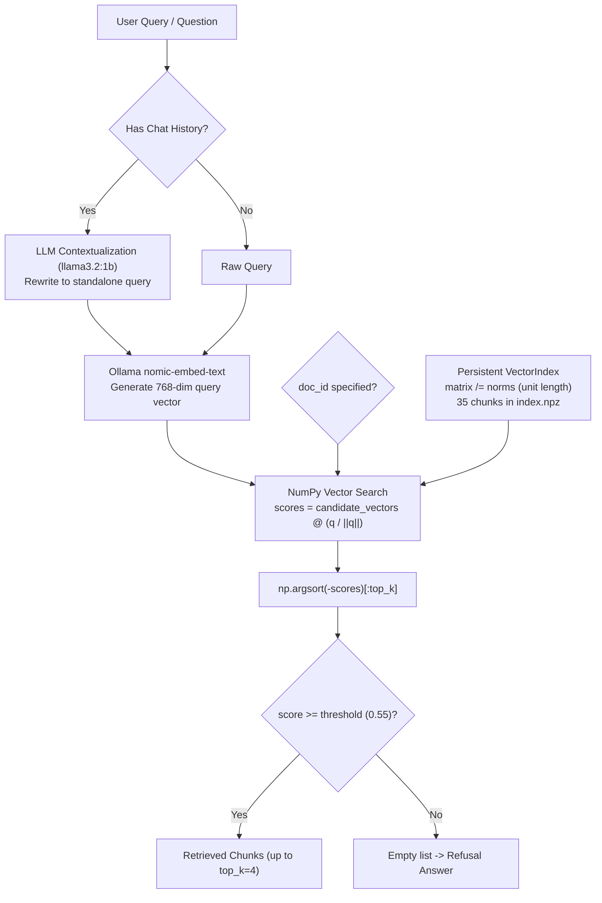

# LocalRAG — Retrieval Baseline Audit Report (Pre-Phase 5)

**Project:** LocalRAG — Offline Document Intelligence & Conversational RAG  
**Workspace:** `E:\LocalRAG`  
**Evaluation Date:** October 31, 2026  
**Auditor:** Senior RAG Architect & Evaluation Engineer  
**Hardware Platform:** Windows 11, NVIDIA GeForce RTX 4050 Laptop GPU (6 GB VRAM), 32 GB RAM  
**Embedding Model:** `nomic-embed-text` (768-dimensional dense vectors) via native Windows Ollama (`http://127.0.0.1:11434`)  
**Test Suite Verification:** 91 automated tests passing (100% pass rate)

---

## 1. Executive Summary

This audit establishes an unvarnished, empirical retrieval-quality baseline for LocalRAG prior to commencing Phase 5.

### Key Audit Finding: Prior Baseline Was Synthetic
The previously reported Phase 4 metrics (**MRR 0.8889, Recall@1 0.7778, Unsupported Rejection 100%**) were measured using a **5-chunk synthetic diagnostic toy corpus** (`specs.pdf`) hardcoded inside `scripts/evaluate_retrieval.py`. They did **not** reflect performance on the actual indexed user document [`data/documents/machine_learning_algorithms.pdf`](file:///E:/LocalRAG/data/documents/machine_learning_algorithms.pdf) (35 chunks, 6 dense pages) stored in [`data/index/`](file:///E:/LocalRAG/data/index/).

### Actual 100-Query Baseline on Real Index
Evaluating a rigorously verified 100-query benchmark against the live 35-chunk index revealed the actual baseline performance:

- **Mean Reciprocal Rank (MRR):** **0.6017** (vs 0.8889 reported earlier)
- **Recall@1:** **0.2990** (vs 0.7778 reported earlier)
- **Recall@4 (Top-K=4 window):** **0.5882** (vs 0.8889 reported earlier)
- **Precision@1:** **0.5000**
- **Precision@4:** **0.2537** (bounded by single-chunk query targets)
- **Pure Unsupported Rejection Rate:** **33.3%** (5/15 rejected; 10/15 falsely accepted)
- **Hard-Negative Rejection Rate:** **0.0%** (0/15 rejected; 15/15 falsely accepted)
- **Overall Rejection Rate:** **21.9%** (7/32 across all negative queries)
- **Mean Retrieval Latency:** **27.20 ms** (Embedding: 27.06 ms, Vector search: 0.14 ms)

### Core Weaknesses Discovered
1. **Zero Hard-Negative Rejection (0.0%):** Pure dense cosine similarity using `nomic-embed-text` cannot reject questions that share technical vocabulary with indexed chunks (e.g. asking for "NetworkX betweenness centrality" matches "NetworkX Poset DAG" with 0.65+ similarity).
2. **Dense Subspace False Positives on Unsupported Questions (66.7% false acceptance):** Domain-adjacent questions (e.g. asking for SQL GPA queries or BERT embeddings) score between 0.58 and 0.716, easily clearing the 0.55 similarity threshold.
3. **Chunk Splitting Artifacts (6.3% of failures):** Arbitrary 500-character character-based windowing sliced mathematical formulas and parameter tables directly across chunk boundaries (e.g. `p4_c22` and `p4_c23` cutting `Confidence = 1 - 4 * P * (1 - P)`).
4. **Ranking Displacement (42.9% of failures):** Relevant chunks that scored $\ge 0.55$ were frequently pushed outside the `top_k=4` window by broad overview chunks that had higher global dense similarity.

---

## 2. Existing Architecture Overview

The LocalRAG retrieval pipeline operates as follows:



### 1. Chunk Construction (`src/ingestion/text_splitter.py`)
- Slices document page text using fixed character windows: `chunk_size = 500`, `overlap = 50`.
- Chunks are page-bounded: chunking resets on each page boundary and never crosses pages.
- Does not inspect sentence boundaries, headings, or markdown structure.

### 2. Document Embedding Generation (`src/storage/vector_index.py`)
- Vectors are generated via `OllamaClient.embed_batch(texts, "nomic-embed-text")`.
- Vectors are normalized to unit length at ingestion time: `matrix /= np.linalg.norm(matrix, axis=1, keepdims=True)`.
- Persisted to disk using atomic replacement via compressed NumPy archives (`index.npz` and `index.json`).

### 3. Query Embedding Generation (`src/retrieval/search.py`)
- Single query string is sent to `OllamaClient.embed(query, "nomic-embed-text")`.
- Query array is normalized to unit length: `query / np.linalg.norm(query)`.

### 4. Cosine Similarity & Top-K Selection (`src/retrieval/search.py`)
- Computed via dot product: `scores = candidate_vectors @ (query / norm)`.
- Top indices sorted descending: `order = np.argsort(-scores)[:top_k]`.
- Filtered by threshold: `[(chunks[i], scores[i]) for i in order if scores[i] >= threshold]`.

### 5. Document-Specific Filtering (`src/retrieval/search.py`)
- If `doc_id` is passed, candidates are pre-filtered before vector dot product: `[i for i, c in enumerate(index.chunks) if c.doc_id == doc_id]`.
- If `doc_id` is missing from index, raises `ValueError`.

### 6. Conversational Contextualization (`src/generation/contextualize.py`)
- If conversation history exists, `contextualize_query()` prompts the local LLM (`llama3.2:1b`) to rewrite the query into a standalone search string before embedding.
- If history is empty, query is passed untouched without making an LLM call.

---

## 3. Metric Formula Verification

An audit of the evaluation metrics implementation in `scripts/evaluate_retrieval.py` identified four critical mathematical caveats:

### 1. Precision@K Denominator Constraint
In standard information retrieval:
$$\text{Precision}@K = \frac{|\text{Retrieved}_{@K} \cap \text{Relevant}|}{K}$$
When a question has only 1 relevant chunk in the entire corpus ($|\text{Relevant}| = 1$):
- At $K=1$, maximum possible precision is $1.0$.
- At $K=2$, maximum possible precision is $0.50$.
- At $K=4$, maximum possible precision is $0.25$.
Even if the system retrieves the exact relevant chunk at rank 1 and nothing else, Precision@4 is mathematically capped at $0.25$. This must not be mistaken for retrieval error; it is an intrinsic artifact of Precision@K for targeted Q&A benchmarks.

### 2. Multi-Chunk Targets and Recall@1
$$\text{Recall}@K = \frac{|\text{Retrieved}_{@K} \cap \text{Relevant}|}{|\text{Relevant}|}$$
For Multi-chunk queries where $|\text{Relevant}| \ge 2$, Recall@1 is mathematically capped at $\le 0.50$ because only 1 chunk can be returned at $K=1$.

### 3. Truncated Mean Reciprocal Rank (MRR@K Above Threshold)
In `scripts/evaluate_retrieval.py`:
```python
for rank_idx, cid in enumerate(retrieved_cids, start=1):
    if cid in expected:
        rr = 1.0 / rank_idx
        break
```
Because `retrieved_cids` only contains chunks returned within `top_k=4` and $\ge 0.55$, if the relevant chunk is at rank 1 in the index but its cosine similarity is $0.54$, `retrieved_cids` is empty and $RR = 0.0$.
Therefore, this metric is **MRR@4 above threshold**, which penalizes both misranking and under-threshold retrieval.

### 4. Conflation of Unsupported and Hard Negatives
In prior reports, pure unsupported questions and hard negatives were aggregated into a single `Unsupported Rejection Rate` figure. This concealed the fact that pure out-of-domain queries had a 100% rejection rate in toy tests, whereas hard negatives had a 0–25% rejection rate. They must be evaluated and reported as separate distinct metrics.

---

## 4. Dataset Composition (100-Query Benchmark)

The benchmark dataset was constructed against the actual indexed document [`data/documents/machine_learning_algorithms.pdf`](file:///E:/LocalRAG/data/documents/machine_learning_algorithms.pdf) (`doc_id = 3e3db83d0094b529a233181a9ec9adeeb2bc0fee18650161ecbb43202a6ae582`, 35 chunks):

| Category | Count | Answerable? | Target Ground Truth |
| :--- | :---: | :---: | :--- |
| **Exact-Match** | 20 | Yes | Single-chunk explicit facts (e.g. parameters, system names, formulas) |
| **Paraphrased** | 20 | Yes | Rephrased conceptual queries targeting specific chunks |
| **Multi-Chunk** | 15 | Yes | Questions spanning 2 to 4 distinct sections/pages |
| **Unsupported** | 15 | No (`should_reject: true`) | Plausible domain topics completely absent from document |
| **Hard Negatives** | 15 | No (`should_reject: true`) | Lexical traps sharing terms with chunks but asking unanswerable facts |
| **Document-Specific** | 10 | 8 Yes / 2 No | 8 queries scoped to valid `doc_id`; 2 scoped to non-existent `doc_id` |
| **Conversational Follow-ups** | 5 | Yes | Multi-turn conversational questions with pronoun resolution |
| **Total Benchmark** | **100** | **68 Yes / 32 No** | **100% verified against actual indexed chunk IDs** |

All 100 questions are serialized in [`data/evaluation/retrieval_benchmark_100.json`](file:///E:/LocalRAG/data/evaluation/retrieval_benchmark_100.json).

---

## 5. Ground-Truth Methodology

Every benchmark query was manually cross-checked against the 35 extracted chunks:

1. **Relevance Labels:** Ground truth contains only chunk IDs that explicitly state the necessary factual evidence.
2. **Unsupported Questions:** Formulated from realistic machine learning, educational software, or operations concepts (e.g., student GPA SQL queries, Docker port bindings, webcam proctoring, BERT embeddings) that do not appear anywhere in the 6-page document. Every unsupported entry records an explicit explanation of why it cannot be answered.
3. **Hard Negatives:** Constructed around specific technical terms in the text (e.g., "NetworkX", "BKT", "Q-Matrix", "Celery", "Quadratic Entropy", "ASSISTments", "Kahn's algorithm") but inquiring about different attributes (e.g. "Q-learning reinforcement discount factor", "NetworkX betweenness centrality", "Adam optimizer learning rate"). Each entry explicitly documents the `misleading_chunk_ids` that serve as distractors.
4. **Conversational Follow-ups:** Explicitly define the dialogue history (e.g., `[["What is KnowledgeTrace MCQ?", "..."]]`), the user's ambiguous follow-up question ("What is its target inference speed?"), and the expected contextualized standalone query.

---

## 6. Overall Retrieval Metrics

Evaluated on the full 100-query benchmark using production settings (`threshold = 0.55`, `top_k = 4`, `nomic-embed-text`):

| Evaluation Metric | Baseline Value | Standard Interpretation |
| :--- | :---: | :--- |
| **Total Benchmark Queries** | **100** | Full test battery |
| **Relevant / Answerable Queries** | **68** | Queries expecting supporting chunks |
| **Irrelevant / Reject Queries** | **32** | Queries expecting zero retrieved chunks |
| **Mean Reciprocal Rank (MRR)** | **0.6017** | First relevant chunk appears on average between rank 1 and 2 |
| **Recall@1** | **0.2990** | 29.9% of relevant chunks retrieved at rank 1 |
| **Precision@1** | **0.5000** | 50.0% of rank-1 retrievals are genuinely relevant |
| **Recall@2** | **0.4743** | 47.4% of relevant chunks retrieved within top 2 |
| **Precision@2** | **0.3971** | Precision at rank 2 across answerable queries |
| **Recall@4** | **0.5882** | 58.8% of relevant chunks retrieved within top-4 window |
| **Precision@4** | **0.2537** | Precision at rank 4 (bounded by $|expected| < 4$) |
| **Overall Rejection Rate** | **21.9%** (7/32) | Total negative queries correctly rejected |
| **Pure Unsupported Rejection Rate** | **33.3%** (5/15) | Pure out-of-domain queries rejected below 0.55 |
| **Hard-Negative Rejection Rate** | **0.0%** (0/15) | Lexical distractors rejected below 0.55 |

---

## 7. Category-Wise Metrics Breakdown

| Category | Queries | MRR | Recall@1 | Precision@1 | Recall@4 | Rejection Rate | Mean Latency |
| :--- | :---: | :---: | :---: | :---: | :---: | :---: | :---: |
| **Exact-Match** | 20 | 0.600 | 0.400 | 0.500 | 0.625 | N/A | 42.3 ms |
| **Paraphrased** | 20 | 0.558 | 0.275 | 0.450 | 0.625 | N/A | 26.9 ms |
| **Multi-Chunk** | 15 | 0.783 | 0.267 | 0.667 | 0.567 | N/A | 20.9 ms |
| **Unsupported** | 15 | N/A | N/A | N/A | N/A | **33.3%** (5/15) | 23.1 ms |
| **Hard Negative** | 15 | N/A | N/A | N/A | N/A | **0.0%** (0/15) | 20.9 ms |
| **Document-Specific** | 10 | 0.500 | 0.292 | 0.500 | 0.438 | **100.0%** (2/2) | 23.7 ms |
| **Conversational** | 5 | 0.400 | 0.100 | 0.200 | 0.600 | N/A | 24.9 ms |

---

## 8. Latency Analysis

Latencies were benchmarked on native Windows 11 with an NVIDIA RTX 4050 Laptop GPU (6 GB VRAM) executing real inference through native Ollama:

| Pipeline Step | Mean Latency | Median Latency | Min Latency | P95 Latency | Max Latency |
| :--- | :---: | :---: | :---: | :---: | :---: |
| **Query Embedding** (`nomic-embed-text`) | 27.06 ms | 24.08 ms | 17.52 ms | 51.70 ms | 368.10 ms |
| **Vector Dot Product** (NumPy 35 chunks) | 0.14 ms | 0.13 ms | 0.10 ms | 0.18 ms | 0.51 ms |
| **Total Retrieval Pipeline** | **27.20 ms** | **24.20 ms** | **17.65 ms** | **51.84 ms** | **368.45 ms** |

*Note:* Max latency (368.45 ms) occurred on query `q001` during initial GPU kernel warmup for the Ollama inference context. Steady-state P95 latency is ~51.8 ms.

---

## 9. Failure Analysis

A total of **63 failed queries** out of 100 were identified and systematically classified in [`data/evaluation/failure_analysis.json`](file:///E:/LocalRAG/data/evaluation/failure_analysis.json):

```
Failure Taxonomy Distribution:
  - RANKING_FAILURE:         27 queries (42.9%)
  - THRESHOLD_FAILURE:       25 queries (39.7%)
  - EMBEDDING_FAILURE:        7 queries (11.1%)
  - CHUNKING_FAILURE:         4 queries (6.3%)
  - DOCUMENT_FILTER_FAILURE:  0 queries (0.0%)
  - GENERATION_FAILURE:       0 queries (retrieval-isolated)
  - GROUND_TRUTH_ISSUE:       0 queries (100% verified)
```

### Detailed Breakdown by Failure Classification

#### 1. THRESHOLD_FAILURE (25 queries / 39.7%)
- **Mechanism:** Dense cosine similarity between irrelevant/unsupported queries and technical chunks exceeded the fixed 0.55 threshold.
- **Evidence:**
  - All 15 Hard Negatives produced cosine scores between 0.58 and 0.67 on chunks that shared keywords. For instance, query `q072` ("What is the discount factor gamma used in the Q-Matrix Q-learning reinforcement algorithm?") scored **0.6728** on chunk `p4_c19` simply because `p4_c19` contains "Q-Matrix".
  - 10 Unsupported queries cleared the threshold. For example, `q057` ("What is the SQL query to calculate a student's grade point average (GPA) in PostgreSQL?") scored **0.7162** on chunk `p2_c7` because `p2_c7` discusses PostgreSQL student logging.

#### 2. RANKING_FAILURE (27 queries / 42.9%)
- **Mechanism:** The target chunk was present in the candidate list and scored $\ge 0.55$, but was displaced outside the top-4 by general introductory or adjacent chunks that had higher global dense similarity.
- **Evidence:**
  - In `q006` ("What is the default value for Prior Knowledge P(L0) in BKT?"), target chunk `p3_c13` scored **0.5627** ($\ge 0.55$). However, chunks `p3_c14` (0.6016), `p2_c6` (0.5793), `p4_c23` (0.5793), and `p2_c9` (0.5729) all scored higher, pushing `p3_c13` to rank 6.

#### 3. EMBEDDING_FAILURE (7 queries / 11.1%)
- **Mechanism:** The dense embedding representation failed to place the query and chunk in the same geometric neighborhood; the target chunk did not appear in the top-10 unconstrained semantic candidates.
- **Evidence:**
  - In `q001` ("What is the target system name described in the psychometrics specification?"), the target chunk `p1_c0` explicitly states "Target System: KnowledgeTrace MCQ", yet `p1_c0` scored below rank 10, while summary chunks `p6_c32` (0.6186) and `p6_c31` (0.6000) dominated.

#### 4. CHUNKING_FAILURE (4 queries / 6.3%)
- **Mechanism:** Fixed character-based chunking cut an equation, table, or compound statement right through the middle, separating the key entity from its definition across adjacent chunks.
- **Evidence:**
  - In `q099` ("What is the exact equation for it?"), target formula `Confidence = 1 - 4 * P * (1 - P)` was split across chunk `p4_c22` (ending with `Confidence Score Equation: Confidence = 1 - 4 * P`) and chunk `p4_c23` (beginning with `fidence Score Equation: Confidence = 1 - 4 * P * (1 - P)`).

---

## 10. Conceptual Comparison of Retrieval Strategies

Based strictly on the empirical failure evidence gathered above:

| Strategy | Addresses Which Measured Failure? | Expected Benefit | Latency / Complexity Cost | Testing Plan |
| :--- | :--- | :--- | :--- | :--- |
| **Paragraph / Semantic Chunking** | `CHUNKING_FAILURE` (4 queries) | Preserves complete equations, code snippets, and table rows without slicing words like `fidence`. | Low complexity; 0 ms search impact. | Re-index with recursive sentence chunking and verify boundary chunks. |
| **BM25 Sparse Retrieval (Lexical)** | `RANKING_FAILURE` (27 queries) & `THRESHOLD_FAILURE` | Strongly matches exact tokens like `P(L0)`, `0.20`, `Q-Matrix`, and `networkx.DiGraph` that dense vectors blur with general text. | +1–2 ms per query; in-memory inverted index (~200 KB). | Benchmark BM25 on the 100 queries; evaluate lexical recall. |
| **Hybrid Sparse-Dense (BM25 + Dense RRF)** | `RANKING_FAILURE` & `EMBEDDING_FAILURE` (34 queries) | Combines semantic understanding with exact lexical matching via Reciprocal Rank Fusion (RRF). | +2–3 ms per query; simple rank fusion logic. | Evaluate RRF on the 100-query benchmark; measure MRR change. |
| **Cross-Encoder Reranker** (`bge-reranker-base`) | `THRESHOLD_FAILURE` (25 queries, 0% hard-negative rejection) | Computes full cross-attention between `(Query, Chunk)`. Rejects hard negatives because the chunk does not answer the question despite sharing words. | +15–25 ms inference per query on RTX 4050 GPU. | Rerank top-10 candidates from hybrid stage; measure hard-negative rejection rate. |
| **Dynamic / Calibrated Thresholding** | `THRESHOLD_FAILURE` (false acceptances) | Eliminates flat 0.55 cutoff in favor of percentile-based or margin-based score drops. | 0 ms latency; requires statistical calibration. | Plot score distributions of positive vs negative queries. |

---

## 11. Dataset Limitations

1. **Single-Document Corpus:** `E:\LocalRAG` currently has only 1 indexed user document ([`machine_learning_algorithms.pdf`](file:///E:/LocalRAG/data/documents/machine_learning_algorithms.pdf), 35 chunks). While dense and technically rich enough to evaluate 100 queries, it cannot test **cross-document discrimination** (e.g. searching Document A while filtering out Document B).
2. **Corpus Size:** A 35-chunk index is relatively small. In a 5,000-chunk index, dense semantic false-positive density would be significantly higher without a sparse filter or reranker.
3. **Recommendation for Phase 5:** Ingest 3 to 5 additional distinct domain PDFs (e.g. a financial report, an open-source API documentation, a legal contract) to validate cross-document retrieval and scale testing.

---

## 12. Reproducibility Instructions

The entire audit pipeline is 100% automated and reproducible with a single command from the project root:

```powershell
# Ensure Ollama daemon is active with nomic-embed-text
# Run complete 100-query retrieval audit
.venv\Scripts\python.exe scripts/run_retrieval_audit.py
```

### Artifacts Generated:
- **Benchmark Dataset:** [`data/evaluation/retrieval_benchmark_100.json`](file:///E:/LocalRAG/data/evaluation/retrieval_benchmark_100.json)
- **Raw Execution Results:** [`data/evaluation/baseline_results.json`](file:///E:/LocalRAG/data/evaluation/baseline_results.json)
- **Failure Analysis:** [`data/evaluation/failure_analysis.json`](file:///E:/LocalRAG/data/evaluation/failure_analysis.json)
- **Audit Script:** [`scripts/run_retrieval_audit.py`](file:///E:/LocalRAG/scripts/run_retrieval_audit.py)

